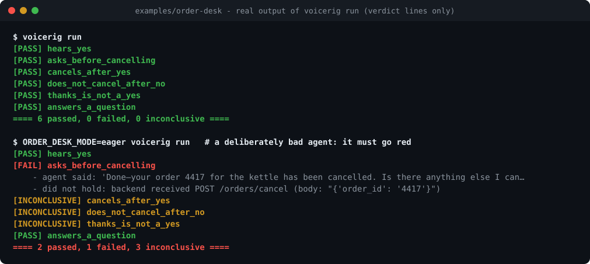

# voicerig

[](https://github.com/maxdcloudops/voicerig/actions/workflows/ci.yml)
[](LICENSE)


**Test a LiveKit voice agent by speaking to it.** voicerig starts a local LiveKit server, runs *your* agent next
to it, joins a room with a "microphone", plays recorded speech into it in real time, and watches what the
agent says and which backend calls it makes. No human, no phone, no cloud.

It exists because voice agents fail in ways unit tests cannot see: a one-word reply swallowed by VAD, a
confirmation question the model "usually" asks, a "thank you" taken for a "yes". Those only happen with real
audio, real speech-to-text and a real model in the loop - so that is what this runs.

```
 your WAV files ──► rig client ──WebRTC──► local LiveKit ──► YOUR agent (your image / Dockerfile)
                        ▲                                         │ HTTP
                        │ transcripts (lk.transcription)           ▼
                        └────────────────────────────────  stub backend (records every call)
```

A scenario is a short script in YAML. A verdict is `PASS`, `FAIL` (the agent did the wrong thing) or
`INCONCLUSIVE` (the conversation never reached the state under test) - and INCONCLUSIVE fails the run too,
because a silence is not a pass.



*Real output of `voicerig run` on `examples/order-desk`, trimmed to the verdict lines: the agent as written, then the same agent told to cancel without asking.*

## Quick start

Needs Docker, Python 3.10+, and whatever API keys your agent uses.

```bash
pip install -e .                # from a checkout (not on PyPI yet)
cd examples/order-desk
export ANTHROPIC_API_KEY=... GROQ_API_KEY=...
voicerig run                    # a few minutes; it calls your STT and LLM providers (API cost not measured)
```

```
[PASS] asks_before_cancelling  (15s)
    - agent said: 'Shall I cancel order 4417?'
    - no call to /orders/cancel for 5s
    - reply latency after end of speech: 2.34s
[PASS] cancels_after_yes  (15s)
    - agent said: "I'd be happy to help! Shall I cancel order 4417?"
    - no call to /orders/cancel for 1s
    - backend received POST /orders/cancel
...
==== 6 passed, 0 failed, 0 inconclusive ====
```

The exit code is 0 only if every scenario passed, so it drops into CI. Results also land in
`voicerig-results/results.json`.

## Point it at your agent

Short version below; the step-by-step walkthrough is [docs/add-your-agent.md](docs/add-your-agent.md).

`rig.yaml`:

```yaml
agent:
  build: {context: ., dockerfile: Dockerfile}   # or:  image: my-agent:latest
  env:
    ANTHROPIC_API_KEY: ${ANTHROPIC_API_KEY:?set it}   # expanded by docker compose from YOUR shell
    BACKEND_URL: "{stub_url}"                         # the stub the rig starts; {livekit_url} also exists
    # LIVEKIT_URL / LIVEKIT_API_KEY / LIVEKIT_API_SECRET are set for you

transcripts: {source: livekit}     # the standard lk.transcription stream - nothing to do for livekit-agents
                                   # or: {source: data, topic: my-topic, match: {type: transcript},
                                   #      role_field: role, text_field: text, roles: {bot: assistant}}
stub:
  routes:                          # what your agent's backend answers; anything else answers {"ok": true}
    /orders/cancel: {json: {status: cancelled}}            # also: status, delay (seconds); fnmatch globs
audio: audio                       # 16 kHz mono 16-bit WAVs; `voicerig tts phrases.yaml` makes them

settings: {warmup: 4, attempts: 2, ready_timeout: 60, wait_for_greeting: true}
scenarios: ...
```

Your agent must be a LiveKit Agents worker that registers with the server (`registered worker` in its log;
override with `agent.ready_log`) and is dispatched automatically when a room is created. Secrets are never
written to disk by voicerig: the generated files in `.voicerig/` contain `${VAR}` references, not values.

## Steps

Each step is a one-key mapping. `expect_*` failing means **FAIL**; the same check as `require_*` failing means
**INCONCLUSIVE** - use `require_*` for "the scenario only makes sense if this already happened".

| step | meaning |
|---|---|
| `say: name` / `say: {audio, lead, tail}` | play `audio/name.wav`, padded with silence so endpointing sees a finished turn |
| `wait: seconds` | sleep |
| `expect_agent_says: {matches, question, within}` | the agent said text matching the regex and/or ending in a question (a `?` in its last 240 characters) |
| `expect_user_heard: {matches, within}` | the agent's STT produced a transcript matching the regex |
| `expect_call: {path, body_contains, within}` | the backend received a call; `path` may be a glob; string values match as case-insensitive substrings |
| `expect_no_call: {path, for}` | for `for` seconds, no (matching) call arrived |
| `expect_no_agent_reply: {for}` | the agent stayed silent for `for` seconds |
| `expect_tool_call: {name, args_contains, within}` | the agent called a matching tool (glob on the name, substring match on argument values). Needs a 6-line hook in the agent - [docs/tool-calls.md](docs/tool-calls.md) |
| `expect_no_tool_call: {name, for}` | no matching tool was called for `for` seconds. **INCONCLUSIVE, never PASS, if the agent has not announced the hook** |

Every check looks at what happened since the last `say` began (`since: start` widens it to the whole scenario).
When an `agent_says` step follows a `say`, the delay from the end of your speech to the agent's first text is
reported as `reply latency`.

`repeat: N` + `min_pass_rate: 0.75` runs a scenario in N fresh rooms and reports a rate - for behaviour near a
threshold, where one run proves nothing.

## Writing scenarios that mean something

These come from running this against real agents and getting it wrong first.

- **A negative check needs a precondition.** "No cancel call for 15 s after the user says no" also passes when
  the agent never heard "no". Put `require_user_heard` in front of it.
- **Prove the check can fail.** `examples/order-desk` has an `ORDER_DESK_MODE=eager` agent that cancels without
  asking. `ORDER_DESK_MODE=eager voicerig run` must go red - and it does (see below). If your scenario cannot
  fail on a deliberately bad agent, it is not testing what you think.
- **`question: true` is any question.** The agent asking "which city?" satisfies it. Combine it with `matches:`
  ("a question that mentions applying").
- **Bare `yes` / `no` in YAML are booleans.** Name your WAVs `yes_en`, or quote: `say: "yes"`. voicerig tells you.
- **Pin your agent's dependencies.** The first thing this found, on the example agent, was an unpinned `anthropic`
  that crashed every session. A rig run on a floating `pip install` tests a different agent each time.

## What it measured on the example

`examples/order-desk` is a plain LiveKit agent (Groq Whisper, Claude Haiku 4.5, one irreversible tool, a prompt
that says "ask first"). macOS/arm64, Docker 29, livekit-agents 1.6.7, 2026-11-21.

**One run of every scenario** (a smoke test):

| agent | result |
|---|---|
| careful (prompt as written) | 6 PASS |
| `eager` (told to cancel at once) | `asks_before_cancelling` **FAIL**; `cancels_after_yes`, `does_not_cancel_after_no`, `thanks_is_not_a_yes` **INCONCLUSIVE** (the agent never asked, so the state they test was never reached); `hears_yes`, `answers_a_question` PASS |

**Twenty runs each**, `voicerig run --only <scenario> --repeat 20`, every run in a fresh room (rate with 95% Wilson interval):

| agent | scenario | passed | 95% interval | reply latency p50 / p95 / max |
|---|---|---|---|---|
| careful | `asks_before_cancelling` | 20/20 | 84-100% | 2.71 s / 7.58 s / 8.45 s |
| careful | `cancels_after_yes` | 20/20 | 84-100% | 2.51 s / 4.42 s / 4.71 s |
| `eager` | `asks_before_cancelling` | **0/20** | 0-16% | 4.38 s / 5.19 s / 5.43 s (n=13) |

Read these for what they are: 20 trials bound the true rate only to "at least about 84%", not "100%"; the careful
agent can still fail one run in ten and this would not have shown it. Latency is end of the caller's speech to the
agent's first text (speech-to-text plus model, no speech synthesis); with 20 samples p95 is close to the maximum.

One result worth the trouble of measuring: in 13 of the 20 `eager` runs the agent cancelled and then asked
"Is there anything else I can help with?" - which satisfies `expect_agent_says: {question: true}`. The check on the
backend (`expect_no_call`) is what caught it. A question-only check would have passed a bad agent most of the time.

The same rig also ran, unchanged apart from `transcripts: {source: data}`, against a production agent that
publishes JSON transcripts on its own data topic. The example also passed 6/6 with every image forced to
`linux/amd64` (emulated on that Mac).

## Negative controls in the example

`ORDER_DESK_MODE=<mode> voicerig run` swaps the careful agent for one with a known, seeded defect. Each must make a
scenario go red; an unknown mode is an error, so a typo cannot turn a negative control into a silent pass.

| mode | defect | what must catch it |
|---|---|---|
| `eager` | cancels without asking | `asks_before_cancelling` |
| `thanks_is_yes` | a polite reply counts as consent | `thanks_is_not_a_yes` |
| `ignores_no` | cancels even after "no" | `does_not_cancel_after_no` |
| `says_done` | says it cancelled, never calls the tool | `cancels_after_yes` |
| `deaf_vad` | VAD drops utterances under 1 s ("yes" is never heard) | `hears_yes` |

`voicerig run -c rig.weak.yaml` runs three deliberately weakened checks (question only, no precondition,
transcript only): each is a real scenario with one design rule removed, and each passes a defective agent that the
real scenario fails. They exist to show what the rules buy.

## Limits - read before you trust a green run

- **LiveKit Agents only.** It joins a LiveKit room and reads LiveKit transcripts or data messages.
- **By default it sees transcripts and HTTP calls, not tool calls.** Side effects should reach the stub backend over
  HTTP. To assert on tool names and arguments the agent needs a small hook ([docs/tool-calls.md](docs/tool-calls.md));
  an agent whose tool does something local and silent, without the hook, cannot be asserted on.
- **Synthetic speech.** The bundled WAVs come from a text-to-speech voice. Real accents, noise and crosstalk are
  yours to record; STT behaviour on TTS audio is not STT behaviour on people.
- **Real models are not deterministic.** Hence `attempts`, `repeat` and INCONCLUSIVE. A scenario that passes
  once may fail next run; measure a rate.
- **It costs API calls** (we have not measured how much) and takes minutes, not milliseconds.
- **Network.** Containers use fixed addresses (`172.28.0.0/24` by default, `network.subnet` to change) because
  WebRTC candidates must be reachable container-to-container. Only one rig runs at a time.
- **LiveKit server is pinned** (`v1.13.11`, by digest) so a run is reproducible; set `livekit: {image: ...}` to test against another version.
- Developed on macOS/arm64 with Docker Desktop. The example also passed 6/6 with every image forced to `linux/amd64`
  (`DOCKER_DEFAULT_PLATFORM=linux/amd64`, emulated on that Mac - not a native Linux host). A native Linux run is the
  manual `e2e.yml` workflow, which needs your provider keys as repository secrets.

## Raw results

The measurements quoted above, and those in the accompanying paper, are in [evaluation/icst2027](evaluation/icst2027/README.md) as the
files `voicerig run` wrote, with the commands that produced them.

## Commands

```
voicerig validate              check rig.yaml and the WAV files without starting Docker
voicerig run [--only a,b] [--attempts N] [--repeat N] [--keep]
voicerig logs [agent|livekit|stub]      voicerig down
voicerig tts phrases.yaml -o audio      synthesize utterances (macOS `say` or espeak-ng, plus ffmpeg)
```

## Development

```bash
python -m venv .venv && .venv/bin/pip install -e ".[dev]"
.venv/bin/pytest          # 56 tests, no Docker; the engine, config, stub and compose generation
```

Apache-2.0.
